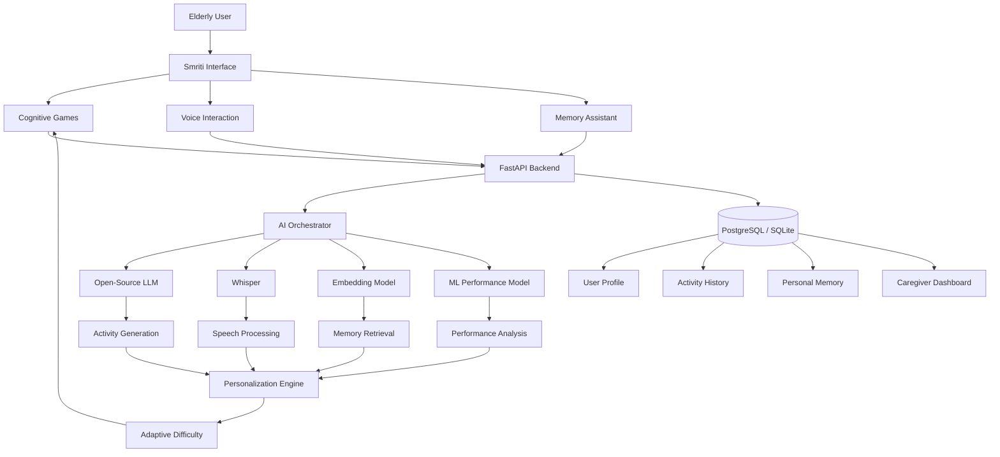
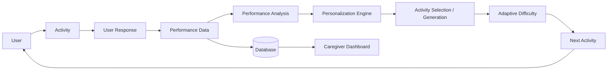
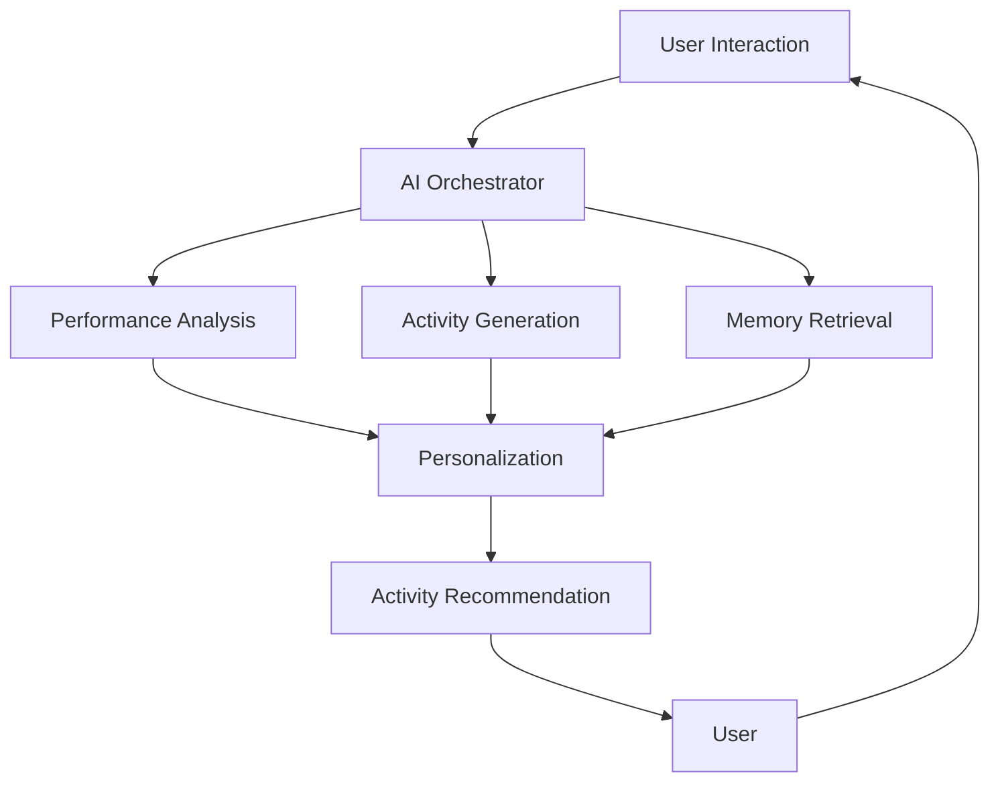
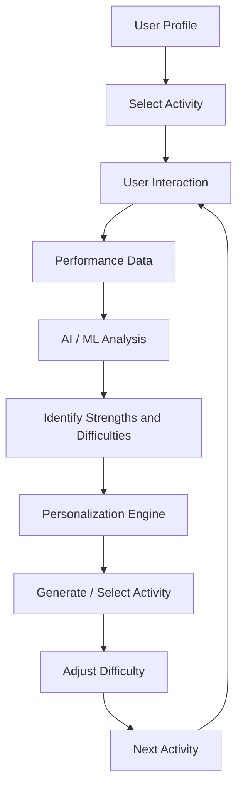

# SMRITI

## Open-Source AI-Powered Cognitive Gaming and Memory Assistance Platform

> **Smriti** is an open-source AI-powered cognitive and memory assistance platform designed to help elderly people with memory and cognitive difficulties through personalized cognitive activities, adaptive difficulty, voice interaction, and contextual memory assistance.

---

## 1. Project Name

# Smriti

### AI-Powered Cognitive Gaming and Memory Assistance Platform

**Hacktober Fest — Problem Statement 1: Best Open-Source AI Project**

---

# 2. Problem Statement

Elderly people experiencing memory and cognitive difficulties may struggle with:

* Memory recall
* Attention and concentration
* Recognition
* Language-based activities
* Remembering everyday information
* Maintaining regular cognitive activities

At the same time, caregivers may find it difficult to continuously provide personalized activities and understand how an elderly user's engagement and performance change over time.

Many existing digital cognitive activities follow a static approach where every user receives the same activities and difficulty levels.

### Our Problem

> **How can open-source AI be used to create a personalized cognitive stimulation and memory assistance platform that adapts to an elderly user's interaction, performance, preferences, and context?**

Smriti addresses this problem by combining cognitive games, AI-powered personalization, voice interaction, and memory assistance in a single platform.

### Scope

Smriti is a **support and cognitive-stimulation platform**.

It is **not a medical diagnostic or treatment system** and does not attempt to diagnose, cure, or medically assess dementia.

---

# 3. Project Overview

Smriti provides an interactive platform for elderly users and caregivers.

### For elderly users

The platform provides:

* Cognitive games
* Memory exercises
* Adaptive difficulty
* AI-generated activity variations
* Voice-based interaction
* Personal memory assistance
* Familiar and culturally relevant content

### For caregivers

The platform provides:

* Activity history
* Performance trends
* Engagement information
* Frequently difficult activity areas
* Difficulty progression
* User-specific activity information

The central component is an **Open-Source AI Personalization Engine**.

Instead of simply giving users predefined games, Smriti creates a feedback loop:

```text
User Interaction
       ↓
Activity / Voice / Memory Assistance
       ↓
Performance & Interaction Data
       ↓
Open-Source AI
       ↓
Performance Analysis
       ↓
Personalization
       ↓
Activity Selection / Generation
       ↓
Adaptive Difficulty
       ↓
Next User Interaction
       ↺
```

This makes AI a core part of the application rather than an optional feature.

---

# 4. Proposed Solution

Smriti combines multiple open-source AI capabilities into one system.

### Core components

```text
                         SMRITI
                           │
              ┌────────────┼────────────┐
              ↓            ↓            ↓
        Cognitive       Voice        Memory
          Games       Interaction    Assistant
              │            │            │
              └────────────┼────────────┘
                           ↓
                 OPEN-SOURCE AI ENGINE
                           │
          ┌────────────────┼────────────────┐
          ↓                ↓                ↓
    Performance        Activity          Context &
      Analysis         Generation        Retrieval
          │                │                │
          └────────────────┼────────────────┘
                           ↓
                  PERSONALIZATION ENGINE
                           ↓
                  ADAPTIVE DIFFICULTY
                           ↓
                    NEXT ACTIVITY
```

The proposed system will:

1. Collect interaction and activity-performance information.
2. Analyze the user's performance.
3. Identify areas where the user performs well or struggles.
4. Select or generate an appropriate activity.
5. Adjust activity difficulty.
6. Support voice-based interaction.
7. Retrieve relevant personal memory information.
8. Provide caregivers with activity and performance information.

---

# 5. Objectives

The objectives of Smriti are:

* Build a meaningful real-world application using open-source AI.
* Make cognitive activities personalized instead of completely static.
* Dynamically adapt activity difficulty according to user performance.
* Generate personalized cognitive activity variations using an open-source model.
* Provide voice-based interaction for elderly users.
* Provide contextual memory assistance.
* Help caregivers understand user engagement and activity performance.
* Support culturally familiar content.
* Build a modular architecture that can be extended with additional AI models and activities.
* Demonstrate meaningful engineering and integration of open-source AI.

---

# 6. Target Users / Use Case

## Primary Users

Elderly people who may experience:

* Memory difficulties
* Attention difficulties
* Difficulty recalling everyday information
* Difficulty interacting with complex digital interfaces

## Secondary Users

Caregivers and family members who want to:

* Monitor engagement
* Review activity performance
* Manage memory-support information
* Understand areas of difficulty
* Observe performance trends

---

## Example Use Case

An elderly user completes three activities:

| Activity        | Score | Performance    |
| --------------- | ----: | -------------- |
| Memory Matching |  8/10 | Good           |
| Sequence Memory |  5/10 | Moderate       |
| Word Recall     |  4/10 | Needs practice |

The personalization engine identifies **Word Recall** as an area requiring additional practice.

Instead of randomly selecting the next activity, Smriti can prioritize an appropriate Word Recall activity with a suitable difficulty level.

---

# 7. Open-Source AI Technology Selected

Smriti will use open-source/open-weight AI components as the central intelligence layer.

### Proposed components

| AI Component     | Candidate Technology           | Role                                                |
| ---------------- | ------------------------------ | --------------------------------------------------- |
| Open-source LLM  | Gemma / Llama / Qwen / Mistral | Activity generation and natural-language assistance |
| Speech AI        | Whisper                        | Speech-to-text                                      |
| Embedding Model  | Sentence Transformers          | Semantic memory retrieval                           |
| ML               | Scikit-learn / PyTorch         | Performance analysis and personalization            |
| AI Orchestration | Custom Python orchestration    | Connect AI components with application logic        |

### Primary AI Component

The **open-source/open-weight LLM** will be the main generative AI component.

It will be used to generate or adapt cognitive activities based on structured information such as:

```text
User Profile
    +
Performance History
    +
Current Difficulty
    +
Cognitive Skill
    +
Preferred Language / Context
          ↓
     Open-Source LLM
          ↓
Personalized Activity
```

The final model will be selected based on:

* Open-source/open-weight availability
* Local inference feasibility
* Model size
* Performance
* Language capabilities
* Hardware requirements
* Response quality

---

# 8. Why This Technology Was Selected

The project is specifically designed around the **Best Open-Source AI Project** track.

The chosen AI technology is not being used simply to add a chatbot.

The open-source AI component is necessary because Smriti requires capabilities such as:

### Personalized Activity Generation

A static database can provide predefined questions, but an LLM can generate variations according to:

* Difficulty
* Cognitive skill
* User interests
* Context
* Language

### Natural Language Interaction

Users can interact with the system using natural language instead of navigating complex menus.

### Contextual Memory Assistance

An embedding model and retrieval layer can help locate relevant information from a user's stored memory information.

### Adaptive Personalization

Structured performance data can be combined with AI reasoning/generation to determine appropriate future activities.

Therefore, open-source AI contributes directly to the core functionality of Smriti.

The PS1 guidelines specifically require the AI component to contribute substantially to the core functionality and reject projects where AI is only an optional add-on or superficial API wrapper.

---

# 9. AI's Role in the System

AI is responsible for four major areas.

## 9.1 AI-Powered Activity Generation

The system can generate activity variations based on:

```text
Cognitive Skill
      +
Difficulty
      +
User Context
      +
Preferred Language
      ↓
Open-Source LLM
      ↓
Structured Activity
```

For example:

```text
Skill: Word Recall
Difficulty: Easy
Context: Familiar food items

        ↓

AI generates:

"Remember these words:
Rice, Mango, River"
```

The system can later ask the user to recall the words.

---

## 9.2 Performance-Based Personalization

The system records:

* Accuracy
* Response time
* Number of attempts
* Mistakes
* Completion rate
* Current difficulty

These values are analyzed to create a user performance profile.

```text
Game Result
     ↓
Performance Features
     ↓
AI / ML Analysis
     ↓
User Cognitive Activity Profile
     ↓
Personalized Recommendation
```

---

## 9.3 Adaptive Difficulty

The system can adjust difficulty according to performance.

Example:

```text
Repeatedly successful
        ↓
Increase difficulty

Performance stable
        ↓
Maintain difficulty

Repeatedly struggling
        ↓
Reduce difficulty
```

This creates an adaptive interaction loop rather than a fixed game sequence.

---

## 9.4 Voice and Memory Assistance

Speech input:

```text
User Speech
    ↓
Whisper
    ↓
Text
    ↓
AI Processing
    ↓
Response
```

For memory assistance:

```text
User:
"What is my daughter's name?"

        ↓

Semantic Retrieval
        ↓

Personal Memory Store
        ↓

Relevant Information
        ↓

AI-generated response
```

---

# 10. System Architecture



---

# 11. Component-Level Architecture

## 11.1 User Interface

The interface contains:

* Elderly user dashboard
* Cognitive games
* Voice interaction
* Memory assistant
* Caregiver dashboard

The elderly interface will prioritize:

* Simple navigation
* Large readable text
* Clear instructions
* Minimal interaction steps

---

## 11.2 Backend

FastAPI will provide APIs for:

* User management
* Activity sessions
* Performance recording
* AI processing
* Memory retrieval
* Personalization
* Caregiver dashboard

---

## 11.3 AI Orchestrator

The AI orchestration layer connects the application with the appropriate AI component.

```text
User Request
      ↓
Request Understanding
      ↓
Identify Required Capability
      ↓
Select AI Component
      ↓
Process Input
      ↓
Validate Output
      ↓
Application Response
```

---

## 11.4 Personalization Engine

The personalization engine combines:

* User profile
* Activity history
* Performance
* Current difficulty
* Cognitive skill
* User preferences

to determine the next appropriate activity.

---

## 11.5 Database

The database stores:

* User profile
* Game sessions
* Scores
* Response times
* Activity difficulty
* Activity history
* Personal memory information
* Caregiver information

---

# 12. Data / Information Flow



### Example

```text
User plays Word Recall
        ↓
User recalls 4 / 10 words
        ↓
Response time recorded
        ↓
Performance analyzed
        ↓
Word Recall identified as weaker area
        ↓
Personalization engine prioritizes Word Recall
        ↓
AI generates a suitable activity
        ↓
Difficulty is adjusted
        ↓
User completes next activity
```

---

# 13. Agentic Workflow

Agentic orchestration is an optional extension of the core architecture.

A modular workflow can be designed as:



### Performance Module

Analyzes the user's activity results.

### Activity Module

Generates or selects appropriate activities.

### Memory Module

Retrieves relevant personal information.

### Personalization Module

Combines the outputs and determines the next appropriate interaction.

This architecture allows agentic capabilities to be added without making them a mandatory dependency for the initial MVP.

---

# 14. Technology Stack

| Layer           | Technology                     |
| --------------- | ------------------------------ |
| Frontend        | React / Flutter                |
| Styling         | Tailwind CSS                   |
| Backend         | FastAPI                        |
| Language        | Python                         |
| Database        | PostgreSQL                     |
| Local Storage   | SQLite                         |
| LLM             | Gemma / Llama / Qwen / Mistral |
| Speech-to-Text  | Whisper                        |
| Embeddings      | Sentence Transformers          |
| ML              | Scikit-learn / PyTorch         |
| AI Ecosystem    | Hugging Face ecosystem         |
| API             | REST                           |
| Deployment      | Docker                         |
| Version Control | Git + GitHub                   |

The final implementation will use the specific components that best satisfy the project's computational and implementation constraints.

---

# 15. Expected Features

##  Cognitive Games

### Memory Matching

Users remember and match objects or images.

### Sequence Memory

Users remember numbers, objects, or sequences.

### Word Recall

Users remember and recall a set of words.

### Picture Memory

Users observe an image and answer questions about it.

### Pattern and Attention

Users identify simple patterns and sequences.

---

##  AI Features

* AI-generated activity variations
* Personalized activity selection
* Adaptive difficulty
* Performance analysis
* Natural-language interaction
* Contextual memory assistance

---

##  Voice Features

* Speech-to-text
* Voice-based queries
* Voice-based activity interaction
* Spoken instructions

---

##  Memory Assistant

Users can access stored information such as:

* Family members
* Important people
* Daily routines
* Important places
* Personal reminders

---

##  Caregiver Dashboard

The dashboard can show:

* Activity history
* Scores
* Accuracy
* Response time
* Difficulty progression
* Engagement
* Frequently difficult activities

---

# 16. Implementation Approach

The implementation will be developed in stages.

## Phase 1 — Core Application

* Frontend
* Backend
* Database
* User profiles
* Basic caregiver dashboard

## Phase 2 — Cognitive Activities

Implement four core activities:

1. Memory Matching
2. Word Recall
3. Sequence Memory
4. Picture Memory

Each activity will generate measurable performance data.

## Phase 3 — Personalization Engine

Create the performance-to-personalization pipeline:

```text
Game Result
    ↓
Feature Extraction
    ↓
Performance Analysis
    ↓
Difficulty Estimation
    ↓
Activity Recommendation
```

## Phase 4 — Open-Source AI Integration

Integrate the selected open-source LLM for:

* Activity generation
* Activity variation
* Natural-language interaction
* Personalized content

## Phase 5 — Voice

Integrate Whisper for speech-to-text interaction.

## Phase 6 — Memory Assistant

Implement:

* Personal memory storage
* Semantic retrieval
* Contextual responses

## Phase 7 — Caregiver Dashboard

Add:

* Historical performance
* Activity trends
* Engagement
* Difficulty changes
* Frequently difficult areas

## Phase 8 — Testing and Deployment

Perform:

* Functional testing
* AI output testing
* Personalization testing
* Usability testing
* Performance testing
* Deployment testing

---

# 17. Expected Final Output

The final implementation will provide two primary interfaces.

## Elderly User

The user will be able to:

```text
Open Smriti
     ↓
View recommended activity
     ↓
Play activity
     ↓
Receive feedback
     ↓
Interact with voice/memory assistant
     ↓
Continue personalized activities
```

## Caregiver

The caregiver will be able to:

```text
Open Dashboard
      ↓
Select User
      ↓
View Activity History
      ↓
View Performance Trends
      ↓
Identify Difficult Areas
      ↓
Review Personalization
```

## AI Output

The AI system will produce:

* Personalized activities
* Activity variations
* Difficulty recommendations
* Natural-language responses
* Retrieved memory information
* Performance-based recommendations

---

# 18. Future Scope / Scalability

## Regional Language Support

The platform can be extended to support languages relevant to the North Eastern Region, subject to availability and testing of suitable open-source models.

Potential future languages include:

* Assamese
* Bengali
* Manipuri / Meitei
* Khasi
* Mizo

Language support will only be considered complete after proper implementation and testing.

---

## Offline AI

Smaller open-source models can eventually be deployed locally to reduce dependence on internet connectivity.

---

## Additional Cognitive Activities

The platform can be extended with activities for:

* Memory
* Attention
* Recognition
* Language
* Pattern recognition
* Problem solving

---

## Personalized Content

The AI can eventually adapt activities according to:

* User interests
* Familiar objects
* Local culture
* Personal memories
* Preferred language

---

## Scalable Architecture

The system can be containerized and deployed using cloud infrastructure.

AI services can be separated into independent services so that individual models can be replaced or upgraded without redesigning the complete application.

---

# 19. Open-Source Dependencies / Components

| Component             | Purpose                                                    |
| --------------------- | ---------------------------------------------------------- |
| Open-source LLM       | Core activity generation and natural-language intelligence |
| Whisper               | Speech recognition                                         |
| Sentence Transformers | Semantic memory retrieval                                  |
| Scikit-learn          | Performance analysis                                       |
| PyTorch               | ML / AI processing                                         |
| FastAPI               | Backend services                                           |
| React / Flutter       | Frontend                                                   |
| PostgreSQL            | Persistent storage                                         |
| SQLite                | Local storage                                              |
| Docker                | Deployment                                                 |

### Open-Source AI Integration

The open-source AI components are integrated into the core workflow:

```text
                   OPEN-SOURCE AI
                         │
        ┌────────────────┼────────────────┐
        ↓                ↓                ↓
   Activity          Voice             Memory
   Generation       Processing        Retrieval
        │                │                │
        └────────────────┼────────────────┘
                         ↓
                 Personalization
                         ↓
                  User Experience
```

The project does not depend on a proprietary hosted AI API as its primary intelligence layer.

---

# 20. Expected Challenges and Mitigation

| Challenge                                           | Mitigation                                                                    |
| --------------------------------------------------- | ----------------------------------------------------------------------------- |
| Elderly users may find complex interfaces difficult | Use simple layouts, large text and clear instructions                         |
| AI may generate unsuitable activities               | Use structured prompts, predefined templates and output validation            |
| LLM output may be inconsistent                      | Use structured output formats and validation rules                            |
| AI models may require significant hardware          | Evaluate smaller models and optimized/quantized inference                     |
| Speech recognition may vary across accents          | Test with representative speech and provide text alternatives                 |
| Regional language models may have limited support   | Begin with supported languages and expand after validation                    |
| Personal information is sensitive                   | Use authentication, authorization and secure data storage                     |
| Performance may be misinterpreted                   | Treat results as activity/engagement indicators rather than medical diagnosis |
| Users have different abilities                      | Establish a baseline and adapt difficulty gradually                           |
| Internet connectivity may be unreliable             | Support local caching and explore offline AI capabilities                     |

---

# AI Feedback Loop

The core technical idea behind Smriti is the **AI-powered personalization feedback loop**.



This transforms Smriti from a collection of static games into an **adaptive AI-powered system**.

---

# Why Smriti Fits Problem Statement 1

Problem Statement 1 requires an original and useful application where open-source/open-weight AI is a **central part of the system**. It specifically expects meaningful engineering, architecture, data flow, implementation choices, and a functional final project.

Smriti addresses these requirements through:

| PS1 Requirement                 | Smriti Implementation                               |
| ------------------------------- | --------------------------------------------------- |
| Real-world problem              | Cognitive and memory support for elderly users      |
| Defined target users            | Elderly users + caregivers                          |
| Open-source AI                  | LLM + Whisper + embeddings + ML                     |
| AI central to system            | Personalization, generation, voice and memory       |
| Meaningful engineering          | Frontend + backend + AI orchestration + database    |
| AI interaction with application | Performance → AI → personalization → next activity  |
| Architecture                    | Modular AI + backend architecture                   |
| Data flow                       | User → performance → AI → personalized activity     |
| User-facing outcome             | Adaptive cognitive activities and memory assistance |
| Scalability                     | Modular AI services and extensible activity system  |

---

# Expected Impact

Smriti aims to make cognitive activities:

* More personalized
* More accessible
* More engaging
* Easier to interact with
* More culturally familiar
* More useful for caregivers

The system focuses on a simple principle:

> **Observe → Analyze → Personalize → Interact → Adapt**

---

# Project Scope

### MVP

The final hackathon implementation will prioritize:

* 4 polished cognitive activities
* AI-powered adaptive difficulty
* Open-source AI-generated activity variations
* Voice interaction
* Personal memory assistant
* Caregiver dashboard
* Performance tracking
* AI personalization feedback loop

Additional languages, activities, and advanced agentic capabilities will be considered after the core system is functional.

---

# Conclusion

**Smriti** is an open-source AI-powered cognitive gaming and memory assistance platform that addresses a meaningful real-world problem through personalized digital interaction.

Unlike a conventional cognitive-game application, Smriti uses open-source AI as part of its core workflow.

The system:

```text
Understands User Interaction
          ↓
Analyzes Performance
          ↓
Personalizes Activities
          ↓
Generates / Selects Content
          ↓
Adapts Difficulty
          ↓
Learns From New Interaction
```

This creates a continuous AI-driven personalization loop that forms the foundation of the project.

> **Smriti — Personalized cognitive support powered by open-source AI.**
